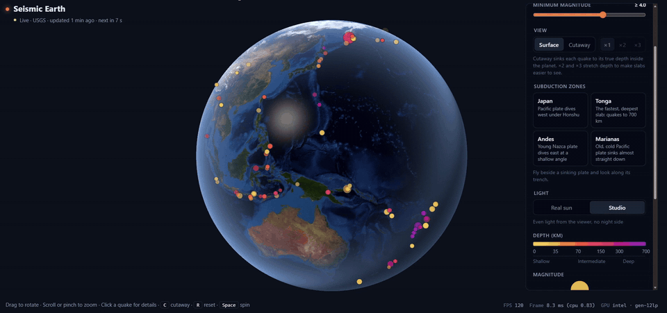
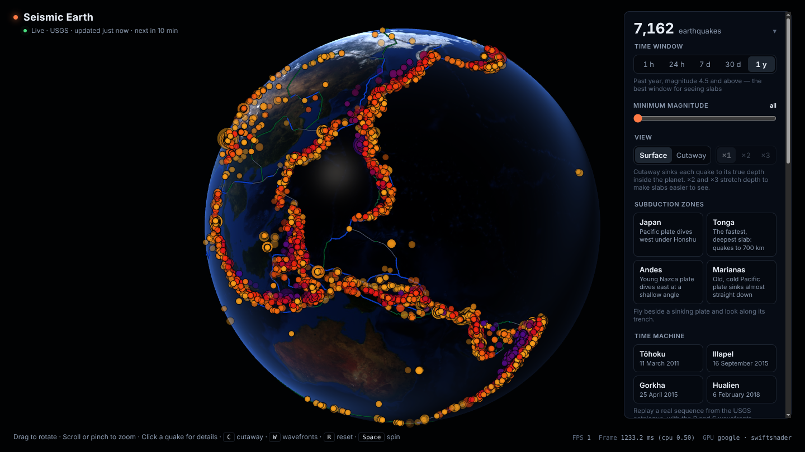
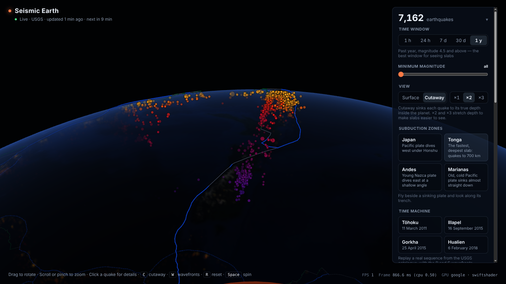
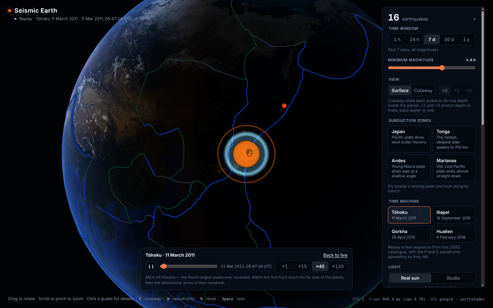
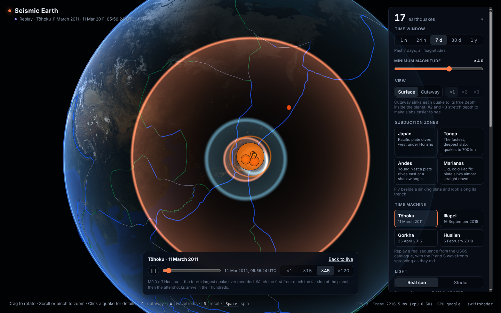
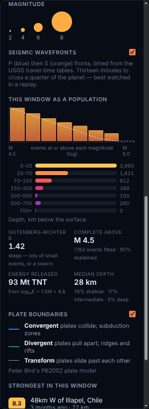

# Seismic Earth

**A real-time globe of the world's earthquakes, rendered in raw WebGPU.** Quakes stream in from the global seismic networks, sink to their true depth to reveal the tectonic plates diving under continents, and send their P and S waves across the surface at the speed the travel-time tables say they travelled.



**[Live demo](https://viktorshishkoski.github.io/seismic-earth/)** · No engine, no framework: ~6,000 lines of TypeScript and hand-written WGSL, a ~1,900-line Node service that merges two seismic networks, and 175 tests.

---

## What it does

**Shows every earthquake, live.** The browser polls the USGS feeds — the past hour, day, week, month, or a year of M4.5+ — and draws all of them in a single instanced draw call. Size is magnitude, colour is depth, recent events pulse, and anything new that arrives while you watch announces itself. A year of M4.5+ events traces the Ring of Fire without anyone having to draw it:



**Cuts the planet open.** Press <kbd>C</kbd> and every quake drops from the surface to its real depth inside the Earth, down to 700 km. Fly along a trench and the scatter resolves into a sheet: the Wadati–Benioff zone, the slab of oceanic plate sinking into the mantle, with the colour ramp marking how deep each quake sat. This is the Tonga slab — the fastest and deepest on the planet — at ×2 depth exaggeration:



**Propagates the actual waves.** Each quake radiates a P front and an S front, timed from the USGS travel-time tables rather than expanding at some made-up constant rate. P arrives first and pulls steadily ahead; S follows at a little over half the speed, carrying the shaking that does the damage. Sixty seconds after the M9.0 off Tōhoku, and ten minutes after:

<p align="center">
  
  
</p>

**Replays history.** The time machine plays back real sequences from the catalogue — Tōhoku 2011, Illapel and Gorkha 2015, Hualien 2018 — at up to 120× with a scrubber and a UTC clock. The replay drives the same pipeline as the live feed, so everything behaves exactly as it does on the real stream; only the clock is different. Tōhoku starts six minutes before the M9.0 and runs through the first hours of aftershocks.

**Merges two seismic networks.** An optional relay service subscribes to EMSC's WebSocket push stream *and* polls USGS, deduplicates the two catalogues into one, and pushes changes to the browser in under a second instead of on the next 60-second poll. Click a quake both networks saw and the card shows each one's own solution and which was used.

**Reads the catalogue as a population.** A statistics panel fits the Gutenberg–Richter law to whatever is on screen — the straight line on a log plot that says there are about ten times as many M5s as M6s — and draws the fit over the data so you can see where it breaks down:

<p align="center"></p>

---

## Run it

Requires **Node.js 22.12 or newer** and a WebGPU browser (current Chrome, Edge, Firefox or Safari).

```bash
npm install
npm run dev        # http://localhost:5173 — the globe, polling USGS directly
```

That is the whole app; no server needed. The relay is optional, and the globe picks it up automatically if it's running:

```bash
npm run dev:all    # the relay and the web app together
```

| Command | What it does |
| --- | --- |
| `npm run dev` | Web app with instant reload |
| `npm run server` | The relay on `http://localhost:8787` |
| `npm run dev:all` | Both at once |
| `npm test` | All 175 tests (Vitest) |
| `npm run typecheck` | TypeScript check, no output files |
| `npm run build` | Type-check, then build a static site into `dist/` |

The relay needs no build step and no native modules: Node runs its TypeScript directly, and storage uses Node's own SQLite.

### Controls

| Input | Action |
| --- | --- |
| Drag (mouse, touch, pen) | Rotate the globe; release mid-drag to fling it |
| Scroll / pinch | Zoom |
| Hover a quake | Quick summary |
| Click a quake | Details card (<kbd>Esc</kbd> closes it) |
| Subduction zones (panel) | Fly beside a slab and look along its trench, in cutaway |
| Time machine (panel) | Replay a real sequence; the transport bar appears at the bottom |
| <kbd>C</kbd> | Toggle cutaway |
| <kbd>W</kbd> | Toggle the seismic wavefronts |
| <kbd>R</kbd> | Back to the globe view |
| <kbd>Space</kbd> | Toggle the idle auto-spin |

Every setting lives in the URL, so any view is a link: `?feed=year&view=cutaway&dx=2&sun=studio`, or `?replay=tohoku` to open straight into a replay. `?relay=off` ignores a running relay.

**Best first look:** **Time machine → Tōhoku**, and watch the blue front pull away from the orange one and cross the Pacific.

---

## How it works

The app runs either of two ways, and nothing downstream of the feed can tell which — both satisfy the same `QuakeFeed` interface, and so does the replay.

**Without the relay** (what the deployed demo does):

```
USGS GeoJSON ──poll every 60 s──▶ LiveFeed ──▶ QuakeStore ──diff──▶ renderer + UI
                                   └─ bundled sample if unreachable
```

**With the relay** (`npm run server`):

```
EMSC WebSocket ──push──┐
                       ├─▶ merge ──▶ SQLite ──▶ /live WebSocket ──▶ RelayFeed ──▶ QuakeStore ──▶ renderer + UI
USGS feed ──poll───────┘      │
                        one event per quake,
                        both solutions kept
```

Everything on screen is drawn in one render pass, preceded by one compute pass:

| Layer | What it draws |
| --- | --- |
| `CoreLayer` | The outer core at 2,890 km, for scale in cutaway |
| `GlobeLayer` | The crust — opaque, or a translucent shell in cutaway |
| `PlateLayer` | 5,824 plate-boundary segments, instanced, coloured by boundary type |
| `WaveLayer` | A compute scan for radiating quakes, then one additive pass for the fronts |
| `QuakeLayer` | Every earthquake, one instanced draw call |

---

## Worth a look

The parts of this that took thought, if you're reading the source:

**Waves are asked backwards** — [`src/render/shaders/waves.wgsl`](src/render/shaders/waves.wgsl). The obvious way to draw an expanding front is to work out where it is now and test every pixel against a moving circle, which means inverting the travel-time table every frame and gets the curvature wrong as soon as the front is large. Instead each pixel measures its own angular distance from the epicentre and looks up when the wave arrives *there*, lighting up when the elapsed time matches. One lookup per pixel, both fronts from it, and the curvature is right because the table already knows that a ray diving deeper travels faster.

**The scan is a compute pass, not a CPU filter** — [`src/render/shaders/waveScan.wgsl`](src/render/shaders/waveScan.wgsl). Only a handful of quakes are radiating at any moment, but finding them means checking all of them. The data is already on the GPU for the markers, so a compute shader walks the same instance buffer and compacts the live ones into a 16-slot list with an atomic counter. The counter is allowed to overshoot; the renderer clamps what it reads, so a violent minute draws the first sixteen fronts rather than overflowing anything.

**Two networks, one earthquake** — [`server/src/merge.ts`](server/src/merge.ts). USGS and EMSC detect the same quakes independently and never agree exactly: origin times differ by seconds, epicentres by tens of kilometres, magnitudes by tenths. A shared identifier settles a match outright; otherwise a report must fall inside an ellipsoid of time, distance *and* magnitude at once (45 s, 350 km, 1.5 units). Two reports from the *same* network are never merged — a network does not publish one quake twice, and that guard is what keeps a dense aftershock sequence intact. Checked against the real 2015 Nepal sequence, exactly one pair of distinct events falls inside the gates on the numbers alone, and both are USGS, so the guard catches it.

**Which solution to believe** — position, depth and origin time always come from a single network's solution, because mixing a latitude from one agency with a depth from another invents a hypocentre nobody computed. Magnitude is chosen separately, preferring moment magnitude, which measures energy released and doesn't saturate for large quakes. The card shows both and marks which was used.

**A replay is a feed** — [`src/data/ReplayFeed.ts`](src/data/ReplayFeed.ts). The time machine gets no rendering mode of its own. It satisfies the same interface as the live sources and emits the same snapshot events, so markers, toasts, cards, statistics and wavefronts all behave identically; the only difference is which clock `dataNow()` reads. Events are kept sorted by time, so what's on screen is a contiguous slice and advancing the clock moves two indices rather than rescanning.

**Statistics that admit when they're meaningless** — [`src/data/statistics.ts`](src/data/statistics.ts). A worldwide "all magnitudes" window mixes a dense Californian network recording M1 with global coverage that misses anything under about M4.5. Fit one Gutenberg–Richter slope across that and you get b ≈ 0.3, which isn't physics — it's a map of who was listening. So completeness is chosen by goodness of fit rather than by the fullest bin, and when no threshold explains 90% of the distribution the panel says *mixed coverage — not one population* instead of printing a confident number.

**Horizon culling instead of depth testing** — markers sit exactly on the surface, so depth-testing them against the globe would z-fight. The vertex shader hides any point past the horizon (`dot(p, eye/|eye|) > 1/|eye|`) and fades those near the limb. The CPU picker uses the same test, so you can't click a quake on the far side.

**Assume the stream will break** — a WebSocket held open for days doesn't just drop, it also goes quiet while still looking open. The relay reconnects with exponential backoff and jitter, treats a long silence as failure, and refills what it missed from FDSN on reconnect, so an outage costs latency rather than data.

**Looking across a slab, not down on it** — from above, a slab's quakes differ only in colour. Edge-on along the trench they line up into a dipping sheet. The camera orbits a look-at target that can sit inside the planet, and a focus fade drops quakes more than ~1,000 km away so other slabs don't crowd the line of sight, like the swath a seismologist projects onto a cross-section.

A few more — the world frame, float precision for timestamps, the perceptual colour ramp, cutaway draw order, the solar position model — are documented inline where they apply.

---

## Tests

```bash
npm test     # 175 tests across 15 files
```

They cover the things that are easy to get quietly wrong: coordinate conversion and great-circle distance, the camera's quaternion maths, snapshot diffing, the GeoJSON parser against real malformed features, the depth ramp's perceptual monotonicity, solar position against the equinoxes and solstices, the travel-time tables against textbook figures (S/P ≈ 1.84 at 100°, P crossing a quarter of the planet in ~13 minutes), the replay clock and its windowing, and the Gutenberg–Richter estimator against synthetic catalogues with a known slope.

The relay has its own end-to-end test that runs the whole service against stand-in USGS and EMSC servers: push an event from one, publish it from the other, and assert it appears once with both solutions attached.

---

## The relay

`npm run dev` is the whole app. The relay adds what a browser can't do on its own.

| | Browser alone | With the relay |
| --- | --- | --- |
| Networks | USGS | USGS **+ EMSC** |
| New quakes | next poll, up to 60 s | **pushed**, typically under a second |
| Magnitude | whatever USGS reports | the better of the two scales |
| History | the feed's own window | everything the relay has stored |

```
GET  /health          relay and per-network status
GET  /events?from&to&minMag&limit
GET  /events/:id      one event with every network report behind it
WS   /live            subscribe to a window; snapshot, then changes as they happen
```

Configurable by environment variable: `PORT` (8787), `DB_PATH`, `HISTORY_DAYS` (30), `RETENTION_DAYS` (90), `BACKFILL_MIN_MAG` (2.5), `EMSC` / `USGS` (`off` to run on one network), `ALLOWED_ORIGINS`.

Two networks reporting the same quake is the thing worth demonstrating, and real ones don't arrive on cue — `server/test/fake-networks.mjs` stands in for both services so you can push events by hand.

**One caveat worth knowing:** the EMSC message format is built from their published documentation, not from a recorded live session. The parser is defensive and the tests cover the documented shape, but the first thing to check when running it for real is the `EMSC` line in `/health`: if `rejected` climbs while `received` stays at zero, the shape differs, and `server/src/normalize.ts` is the one place to fix it.

---

## Project layout

```
src/
  main.ts          Wires data, scene and UI together; the frame loop
  data/            Feeds (live, relay, replay), the store, parsing, statistics
  render/          One render pass; a layer per thing drawn; WGSL in shaders/
  geo/             Coordinates, sphere mesh, solar position, travel times, picking
  camera/          Quaternion orbit camera, slab tours, input handling
  gpu/             Device setup, textures, mipmap generation
  ui/              Panel, overlays, time machine, statistics, URL state
server/
  src/             Sources, merge, SQLite store, relay, HTTP + WebSocket API
  test/            Unit tests, an end-to-end test, and stand-in networks
tests/             Vitest unit tests
public/            Earth textures, plate boundaries, bundled catalogue samples
```

Built as a static site (`base: './'`), so `dist/` works on GitHub Pages, Cloudflare Pages, Netlify or any static host. The included workflow runs the tests on every push and deploys `main` to Pages.

How it got here, phase by phase, is in [`docs/development-log.md`](docs/development-log.md).

---

## Data and credits

- **Earthquakes:** [USGS Earthquake Hazards Program](https://earthquake.usgs.gov/) real-time feeds and FDSN event service (public domain). Bundled offline samples: a USGS "all week" snapshot from 1–7 Feb 2018, via [vega-datasets](https://github.com/vega/vega-datasets); the 2015 M4.5+ worldwide year and M4.0+ for 9–18 March 2011 (the Tōhoku replay), via [helloworlddata/usgs-earthquakes](https://github.com/helloworlddata/usgs-earthquakes).
- **Travel times:** USGS, ["Earthquake travel times"](https://www.usgs.gov/programs/earthquake-hazards/earthquake-travel-times) — P and S arrivals for a 33 km source, every 5° of epicentral distance.
- **EMSC real-time service:** [Euro-Mediterranean Seismological Centre](https://www.emsc-csem.org/), via the [SeismicPortal](https://www.seismicportal.eu/realtime.html) WebSocket and FDSN services.
- **Plate boundaries:** Bird, P. (2003), *An updated digital model of plate boundaries*, G³ 4(3), 1027 — PB2002, via [fraxen/tectonicplates](https://github.com/fraxen/tectonicplates).
- **Earth imagery:** NASA Visible Earth — Blue Marble and Black Marble (public domain).
- **Statistics:** completeness by goodness of fit, Wiemer & Wyss (2000), *BSSA* 90(4), 859–869; slope by maximum likelihood, Aki (1965) and Utsu (1965).
